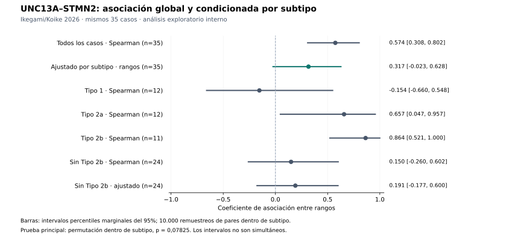

# UNC13A–STMN2: la asociación se atenúa al condicionar por subtipo

Fecha: 10/11/2026. Etiqueta: **reanálisis observacional exploratorio interno**, con los mismos 35 casos. No es replicación independiente.

## Evidencia

La asociación global de Spearman se reproduce exactamente (0,5736694678), pero la correlación entre rangos residualizados por subtipo baja a **0,3166873460**. La prueba principal de permutación dentro de subtipo da **p bilateral = 0,07825** (7.824 permutaciones tan extremas o más, de 99.999; corrección +1). Error estándar Monte Carlo ≈ 0,000849. El intervalo bootstrap marginal del 95% para el coeficiente ajustado es **[−0,0234; 0,6276]**.

**La predicción fijada (coeficiente ajustado positivo y p<0,05) no se cumple.** El resultado no demuestra ausencia de asociación; sigue siendo compatible con una asociación positiva de magnitud incierta.

| Análisis | Coeficiente | Intervalo bootstrap marginal 95% |
|---|---:|---|
| Todos los casos (n=35) | 0.5737 | [0.3084, 0.8025] |
| Ajustado por subtipo (n=35) | 0.3167 | [-0.0234, 0.6276] |
| Tipo 1 (n=12) | -0.1538 | [-0.6596, 0.5484] |
| Tipo 2a (n=12) | 0.6573 | [0.0469, 0.9567] |
| Tipo 2b (n=11) | 0.8636 | [0.5211, 1.0000] |
| Sin Tipo 2b (n=24) | 0.1496 | [-0.2596, 0.6016] |
| Sin Tipo 2b, ajustado (n=24) | 0.1909 | [-0.1769, 0.5999] |

Los coeficientes sin ajustar son Spearman. Los ajustados son correlaciones de Pearson entre rangos globales tras restar las medias de cada subtipo (Spearman parcial respecto de indicadores de subtipo). Los análisis sin Tipo 2b recalculan los rangos sobre los 24 casos restantes. Los coeficientes de subgrupo son descriptivos; **no se ha probado que difieran entre sí** ni se han fijado decisiones de significación para ellos. Los intervalos no son simultáneos.

Cambio ajustado menos global: **−0,25698** puntos de coeficiente; no se interpreta como porcentaje de varianza explicado. Leave-one-pair-out del coeficiente ajustado: **0,19854–0,40677** (35 exclusiones). Ningún intervalo bootstrap tuvo réplicas indefinidas.

## Interpretación

La asociación global es sensible a la composición por subtipo. Al retirar el Tipo 2b, la correlación global queda en 0,1496 y la ajustada en 0,1909, ambas con intervalos amplios que incluyen cero. Por tanto, este depósito **no sostiene con el criterio primario fijado una asociación general adicional a las diferencias entre subtipos**.

A la vez, la estimación dentro del Tipo 2b es alta (0,8636), dentro del Tipo 2a es positiva (0,6573), y dentro del Tipo 1 es ligeramente negativa (−0,1538), con incertidumbre apreciable. Este patrón no autoriza a afirmar que toda la correlación global sea un artefacto de mezcla ni que exista heterogeneidad biológica demostrada. Sugiere una pregunta para comprobación independiente, no una hipótesis confirmada por seleccionar retrospectivamente el subgrupo favorable.

H2 sigue abierta en forma más limitada: no hay apoyo suficiente en esta prueba para una coordinación homogénea generalizable entre subtipos. Las medias de grupo y la posible heterogeneidad requieren atención. Ni p=0,078 ni el intervalo que incluye cero refutan por sí solos H2. No se cambia a un test unilateral ni se redefine el éxito tras ver el resultado.

## Procedencia y ejecución

- Protocolo registrado **antes de recuperar o inspeccionar los valores individuales de este ciclo**, commit [`88fc61f`](https://github.com/luisceb1/ela-research/commit/88fc61f998e5ec77791e76ffdbbd9fccd20a9138), [texto](../../research/plans/2026-11-10-ikegami-subtype-conditioning.md). El rho global y los tamaños de grupo ya eran conocidos; no es un estudio confirmatorio independiente.
- Fuente: Ikegami/Koike 2026, DOI 10.1186/s40478-026-02400-0, Additional file 3. [Descarga exacta](https://static-content.springer.com/esm/art%3A10.1186%2Fs40478-026-02400-0/MediaObjects/40478_2026_2400_MOESM3_ESM.xlsx).
- XLSX de **29.237 bytes**, SHA256 `d72b8ebc18c1b71be8bc4c26ffde1edd6f5da65541a7711c686073f4a36ad385`, idéntico al del replay anterior. El original no se versiona ni se redistribuyen observaciones.
- Solo `Fig. 2c`: parejas explícitas A/B (Tipo 1), A/C (Tipo 2a), A/D (Tipo 2b); grupos **12/12/11**, sin parejas incompletas ni filas vacías. Cabeceras y celdas usadas están en [results.json](results.json). No se enlaza ninguna hoja por posición de fila ni se recuperan identidades de casos.
- Se reprodujeron los fallos de acceso de rutas alternativas (PMC devolvió HTML; Springer CDN falló; Europe PMC supplementaryFiles no completó una descarga verificable). La ruta `static-content.springer.com` sí produjo el archivo con hash exacto. No se usaron los archivos alternativos como datos.
- El primer intento de ejecución se detuvo al leer las cabeceras: el adaptador esperaba espacio antes de `ALS Type`, pero el archivo usa guion bajo. Se amplió exclusivamente el reconocimiento de ese delimitador y su prueba; **no se calculó ningún estadístico antes de esa corrección** ni se cambió el protocolo estadístico.
- Prueba principal: 99.999 permutaciones, semilla 20261110, bilateral, grupos preservados. Bootstrap de pares dentro de subtipo: 10.000 réplicas, semilla 20261111, rangos recalculados en cada réplica. La distribución nula requiere intercambiabilidad de los pares dentro de cada subtipo; no prueba causalidad.
- Entorno ejecutado: Python 3.12.14, numpy 2.3.5, scipy 1.17.0, openpyxl 3.1.5. CI conserva el manifiesto existente (numpy 2.3.4). La figura usa matplotlib 3.10.8 como dependencia opcional, sin intervenir en los cálculos.

## Verificación

**22 pruebas focalizadas pasan sin omisiones:** 10 nuevas del análisis condicionado, 6 del replay anterior y 6 del cribado de covariables; [registro](tests.json). Los ejemplos construidos solo verifican software y no cuentan como evidencia biológica. La prueba de agrupamiento puro produce asociación global alta y coeficiente ajustado cero; la de asociación dentro de grupos conserva la señal. Se comprueban empates, claves de grupo, pares incompletos, hash incorrecto, bootstrap degenerado y permutaciones estratificadas reproducibles.

Comprobación adicional con los datos reales mediante mínimos cuadrados sobre indicadores de grupo y rangos: coeficiente **0,31668734600768067**, diferencia absoluta **0** respecto del algoritmo por centrado de medias. Es una comprobación computacional por otra formulación matemática, no revisión científica independiente. Figura renderizada y revisada visualmente.

La suite completa queda a cargo de CI en el commit de esta PR; no se declara ejecutada localmente porque esta sesión recuperó solo los archivos necesarios mediante el conector. El estado final de CI se documentará por commit.

## Correcciones del informe anterior

Se conservan sus resultados numéricos y se corrigen REPORT, STATE y BACKLOG:

1. p≥0,05 no demuestra equivalencia ni permite descartar RIN, PMI, pérdida neuronal o duración como contribuyentes.
2. Recalcular estadísticas de los mismos casos es reproducibilidad interna, no confirmación independiente.
3. Spearman al cuadrado no se presenta como proporción de varianza de niveles de RNA explicada.
4. Atenuar o conservar una asociación al ajustar por una medida de patología no identifica por sí solo un mecanismo. La carga de agregados pTDP-43 no se equipara a pérdida de función nuclear.

## Limitaciones y siguiente experimento

35 casos post mortem, subgrupos de 11–12. Las medidas de abundancia por PCR no son cuentas de uniones ni rescate funcional. El ajuste por subtipo no controla edad, duración, calidad del RNA, composición celular, normalización compartida o pérdida nuclear de TDP-43. La clasificación del subtipo podría estar en la trayectoria causal: no se presupone que sea un confusor causal. Los intervalos percentiles pequeños pueden tener cobertura imperfecta y no incorporan error de medida ni incertidumbre de asignación de subtipo.

Siguiente paso propuesto: una **fuente independiente** con ambos marcadores, unidades biológicas verificables, covariables enlazables y una medida justificada de función nuclear de TDP-43. Si permite estratificar, fijar antes del análisis una prueba de modificación de asociación por subtipo; no extrapolar retrospectivamente el Tipo 2b favorable. Antes de un nuevo cálculo, comprobar diseño y precisión esperable. No buscar significación ampliando iterativamente este depósito.

**Ciclo cerrado. #37 y #44 siguen bloqueadas** por las entradas ya registradas; este análisis no aporta esas entradas. Sin comunicaciones, gastos, nuevas cohortes procesadas, intervenciones ni recomendaciones clínicas.
